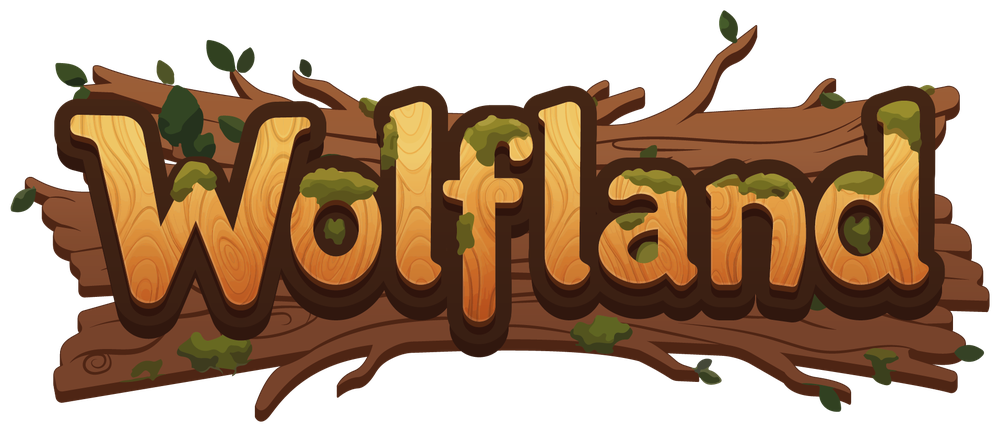

{ .center width="420" }

# Bienvenido

Bienvenido a la wiki oficial de **Wolfland Network**, un servidor de Minecraft **Survival Custom**. Aquí encontrarás cómo entrar, las reglas, los comandos, los rangos y todas las novedades de la comunidad.

  

    
    IP del servidor
    Java &amp; Bedrock
  

  

    

      

        Java
        <code class="wf-ip-code">play.wolfland.pro</code>
      

      <button type="button" class="wf-copy-btn" onclick="copyServerIp(this, 'play.wolfland.pro')">
        <svg viewBox="0 0 24 24" width="15" height="15" fill="none" stroke="currentColor" stroke-width="2" stroke-linecap="round" stroke-linejoin="round"><rect x="9" y="9" width="13" height="13" rx="2" ry="2"></rect><path d="M5 15H4a2 2 0 0 1-2-2V4a2 2 0 0 1 2-2h9a2 2 0 0 1 2 2v1"></path></svg>
        Copiar IP
      </button>
    

    

      

        Bedrock
        <code class="wf-ip-code">play.wolfland.pro</code>
        Puerto: <code class="wf-ip-code">19132</code>
      

      <button type="button" class="wf-copy-btn" onclick="copyServerIp(this, 'play.wolfland.pro:19132')">
        <svg viewBox="0 0 24 24" width="15" height="15" fill="none" stroke="currentColor" stroke-width="2" stroke-linecap="round" stroke-linejoin="round"><rect x="9" y="9" width="13" height="13" rx="2" ry="2"></rect><path d="M5 15H4a2 2 0 0 1-2-2V4a2 2 0 0 1 2-2h9a2 2 0 0 1 2 2v1"></path></svg>
        Copiar IP + Puerto
      </button>
    

  

[:fontawesome-brands-discord: Unirse al Discord](https://discord.com/invite/jCmngqZRFV){ .md-button .md-button--primary }
[:fontawesome-solid-store: Ir a la Tienda](https://wolfland.tebex.store/){ .md-button }
{: .cta-buttons .center }

## Empieza por aquí

- [Cómo unirse](unirse.md): IP, puertos y pasos para Java y Bedrock.
- [Reglas](reglas.md): las normas detalladas del servidor.
- [Comandos](comandos.md): todos los comandos disponibles.
- [Rangos](rangos.md): rangos de jugador y staff, con sus beneficios.
- [Creadores de contenido](rangos-media.md): requisitos para obtener un rango media.
- [Noticias](noticias.md): últimas actualizaciones.
- [Discord](https://discord.com/invite/jCmngqZRFV): únete a la comunidad, abre tickets y habla con el staff.
- [Tienda](https://wolfland.tebex.store/): tienda oficial del servidor.

## Sobre el servidor

Wolfland Network es un servidor **Survival Custom**: la experiencia clásica de supervivencia, con contenido y mecánicas propias.

*Aquí puedes añadir una descripción más completa: qué cambia respecto al survival normal, qué mecánicas propias hay y cómo nació la comunidad.*
