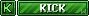
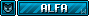

# Rangos Media

El programa de creadores de contenido de **Wolfland Network**. Si haces videos, reels o transmisiones del servidor, puedes obtener un rango media.

{ .rank-tag-lg } { .rank-tag-lg } { .rank-tag-lg } { .rank-tag-lg }

[:fontawesome-brands-discord: Postular por ticket](https://discord.com/invite/jCmngqZRFV){ .md-button .md-button--primary }
[:material-handshake: Servicios de contenido](servicios.md){ .md-button }

---

## Requisitos

Para cada plataforma se pide un mínimo de alcance:

| Etiqueta | Plataforma | Contenido válido | Seguidores mínimos |
|:--------:|------------|------------------|--------------------|
| { .rank-tag } | **TikTok** | Videos con más de **200 vistas**<br>Lives con **10 a 50+ viewers** | Sin mínimo |
| { .rank-tag } | **YouTube** | Videos con más de **500 vistas**<br>Reels con más de **1000 vistas** | **100** suscriptores |
| { .rank-tag } | **Twitch** | Transmisiones con mínimo **10 viewers** | **50** seguidores |
| { .rank-tag } | **Kick** | Igual que Twitch: transmisiones con mínimo **10 viewers** | **50** seguidores |

!!! note "Cómo se miden"
    Se revisan los **datos de una semana** de tu contenido sobre el servidor.

---

## Equivalencia de rango

Todos los rangos media equivalen a un rango **Alfa** del servidor. Consulta sus beneficios en [Rangos Premium](rangos-premium.md).

| Equivalencia | Etiqueta | Requisitos |
|--------------|:--------:|------------|
| **Alfa** | { .rank-tag } | Los requisitos base de la tabla anterior |
| **Omega** | { .rank-tag } | El doble de los requisitos base |
| **Wolf** | { .rank-tag } | El triple de los requisitos base |

- Si quieres la equivalencia de **Omega** o **Wolf**, **indícalo al postular o al reclamar tu rango**.
- Si tus requisitos mejoran de forma notable, se te dará una **mejora de rango sin necesidad de pedirla**.

---

## Beneficios

Además del rango equivalente dentro del servidor, los creadores tienen beneficios en nuestro [Discord](https://discord.com/invite/jCmngqZRFV):

| Beneficio | Detalle |
|-----------|---------|
| **Rango en el servidor** | El rango equivalente: **Alfa**, **Omega** o **Wolf**, según tus requisitos |
| **Rol en Discord** | Un rol acorde a tu rango media |
| **Canal de redes sociales** | Un canal donde se publica una **alerta** cuando prendes un live, transmites o subes un video en las redes con las que eres creador |
| **Canal exclusivo** | Acceso a un canal único para los rangos media |

---

## Actividad mínima

!!! warning "Mínimo 2 publicaciones por semana"
    Debes **subir videos o hacer transmisiones del servidor al menos 2 veces por semana**.

    Si no cumples, el rango se **removerá sin previo aviso**.

---

## Obligaciones del creador

Todo creador con rango media debe cumplir con lo siguiente:

1. **Mencionar y etiquetar** las redes oficiales del servidor en la plataforma donde crea contenido. Se te entregan al postular o al abrir un ticket.
2. Poner el hashtag **`#wolflandnetwork`** en la descripción de sus videos, reels y transmisiones.
3. Incluir en la descripción la **IP y el puerto**, junto con el **enlace de Discord**.

Puedes copiar esta plantilla para tus descripciones:

```text
#wolflandnetwork
IP: play.wolfland.pro
Puerto Bedrock: 19132
Discord: https://discord.com/invite/jCmngqZRFV
```

!!! warning "Si no se cumple"
    Se te llamará la atención o se te removerá el rango.

---

## Prohibiciones

1. **Ningún rango media recibe permisos de administrador ni objetos OP.**
2. **No se puede exigir nada al staff.** Los creadores siguen las [reglas generales](reglas.md) del servidor como cualquier otro miembro, con o sin rango premium.
3. **No hacerse pasar por dueños o staff** del servidor.
4. **No publicar otra IP u otro servidor** en transmisiones ni en videos.

!!! note "Las mismas reglas aplican"
    Los creadores deben seguir las reglas del servidor y del Discord **como un usuario más, no como staff**.

---

## Resumen de sanciones

| Incumplimiento | Consecuencia |
|----------------|--------------|
| Menos de 2 publicaciones por semana | Se remueve el rango **sin previo aviso** |
| No incluir `#wolflandnetwork`, IP, puerto o Discord | Llamado de atención o remoción del rango |
| Publicar otra IP u otro servidor | Se remueve el rango |

---

## Recompensas

!!! info "Rangos no remunerados"
    Ningún rango media recibe pago ni recompensa monetaria, salvo que se genere un **contrato directo bajo términos y condiciones**. Son excepciones, **no cualquiera puede obtenerlo**.

---

## Cómo postular

1. Abre un **ticket** en nuestro [Discord](https://discord.com/invite/jCmngqZRFV).
2. Indica tu **plataforma** y el enlace a tu canal o cuenta.
3. Comparte los **datos de la última semana** de tu contenido.
4. Si aspiras a **Omega** o **Wolf**, especifícalo en tu solicitud.
5. Recibirás las **redes oficiales del servidor** para que las etiquetes y menciones.

[:fontawesome-brands-discord: Abrir ticket](https://discord.com/invite/jCmngqZRFV){ .md-button .md-button--primary }
