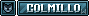
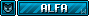
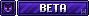
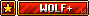

# Rangos Premium

Los rangos premium de **Wolfland Network** te dan una etiqueta exclusiva, kits, más capacidad para jugar y comandos exclusivos. Cuanto más alto el rango, más beneficios, e **incluye todo lo de los rangos anteriores**.

!!! tip "Descuentos por tiempo limitado"
    Cada cierto tiempo hay **descuentos en los rangos**. Se anuncian en nuestro [Discord](https://discord.com/invite/jCmngqZRFV), así que únete para no perderte ninguna oferta.

!!! info "Rango Miembro"
    { .rank-tag }

    Es el **rango inicial**: el que recibe todo jugador al entrar por primera vez al servidor. No incluye beneficios extras. Los rangos de esta página son mejoras sobre él.

[:fontawesome-solid-store: Ver la tienda](https://wolfland.tebex.store/){ .md-button .md-button--primary }
[:fontawesome-brands-discord: Unirse al Discord](https://discord.com/invite/jCmngqZRFV){ .md-button }

---

## Comparativa de rangos

| Beneficio | Colmillo | Alfa | Omega | Beta | Wolf | Wolf+ |
|-----------|:--------:|:----:|:-----:|:----:|:----:|:-----:|
| **Etiqueta en el servidor** | { .rank-tag } | { .rank-tag } | { .rank-tag } | { .rank-tag } | { .rank-tag } | { .rank-tag } |
| **Rol de Discord** | `@COLMILLO` | `@ALFA` | `@OMEGA` | `@BETA` | `@WOLF` | `@WOLF+` |
| **Kit** | Colmillo | Alfa | Omega y Épico | Beta y anteriores | Wolf y anteriores | Wolf+ y anteriores |
| **Frecuencia del kit** | 15 días | 15 días | 15 días | 15 días | 15 días | 14 días |
| **Homes en mundos de recursos** | 5 | 8 | 16 | 24 | Infinitos | Infinitos |
| **Subastas simultáneas** `/ah` | — | 5 | 8 | 12 | 20 | 20 |
| **Trabajos simultáneos** `/jobs` | — | 5 | 10 | 15 | Todos | Todos |
| **Misiones simultáneas** `/quest` | 5 | 8 | 12 | 16 | Todas | Todas |
| **Llaves de Caja Legendaria** | x5 | x6 | x7 | x8 | x9 | x10 |
| **Bóvedas personales** `/pv` | 3 | 4 | 5 | 6 | 8 | 10 |
| **Protecciones** | 4 | 6 | 8 | 5 | 12 | 15 |
| **ShopChest** (tiendas con cofres) | 20 | 30 | 50 | 80 | 80 | 100 |
| **Pwarps** (warps personales) | 2 | 3 | 4 | 5 | 7 | 10 |
| **`/tpa` sin espera** | ✅ | ✅ | ✅ | ✅ | ✅ | ✅ |

---

## Comandos exclusivos

Comandos que se desbloquean con cada rango. ✅ significa que el rango tiene acceso.

### Teletransporte y movimiento

| Comando | Descripción | Colmillo | Alfa | Omega | Beta | Wolf | Wolf+ |
|---------|-------------|:---:|:---:|:---:|:---:|:---:|:---:|
| `/tpahere` | Teletransporta a un jugador hacia ti | — | ✅ | ✅ | ✅ | ✅ | ✅ |
| `/tpauto` | Te teletransporta a otros jugadores de forma aleatoria | — | — | ✅ | ✅ | ✅ | ✅ |
| `/top` | Te mueve al punto más alto del mundo | — | — | — | — | ✅ | ✅ |
| `/afk` | Permite estar AFK de forma infinita | — | — | ✅ | ✅ | ✅ | ✅ |
| `/depth` | Revela tu posición en el mundo | — | — | — | ✅ | ✅ | ✅ |
| `/fly` | Vuela por Supervivencia, Nether y End | — | — | — | — | — | ✅ |

### Almacenamiento y utilidades

| Comando | Descripción | Colmillo | Alfa | Omega | Beta | Wolf | Wolf+ |
|---------|-------------|:---:|:---:|:---:|:---:|:---:|:---:|
| `/pv` | Abre tus bóvedas personales (la cantidad depende del rango) | ✅ | ✅ | ✅ | ✅ | ✅ | ✅ |
| `/ec` | Abre tu enderchest | — | — | ✅ | ✅ | ✅ | ✅ |
| `/craft` | Abre la mesa de crafteo | ✅ | ✅ | ✅ | ✅ | ✅ | ✅ |
| `/clear` | Borra todo tu inventario | ✅ | ✅ | ✅ | ✅ | ✅ | ✅ |
| `/disposal` | Abre un menú de basurero | ✅ | ✅ | ✅ | ✅ | ✅ | ✅ |
| `/recipe` | Abre el menú de recetas | — | — | — | — | ✅ | ✅ |
| `/condense` | Para fundir minerales | — | — | — | — | ✅ | ✅ |

### Mesas de trabajo

| Comando | Descripción | Colmillo | Alfa | Omega | Beta | Wolf | Wolf+ |
|---------|-------------|:---:|:---:|:---:|:---:|:---:|:---:|
| `/anvil` | Abre un yunque | — | — | ✅ | ✅ | ✅ | ✅ |
| `/smithingtable` | Abre la mesa de herrería | — | — | — | ✅ | ✅ | ✅ |
| `/cartographytable` | Abre la mesa de cartografía | — | — | — | ✅ | ✅ | ✅ |
| `/grindstone` | Abre el afilador | — | — | — | ✅ | ✅ | ✅ |
| `/loom` | Abre el telar | — | — | — | ✅ | ✅ | ✅ |
| `/stonecutter` | Abre la cortadora de piedra | — | — | — | ✅ | ✅ | ✅ |

### Salud

| Comando | Descripción | Colmillo | Alfa | Omega | Beta | Wolf | Wolf+ |
|---------|-------------|:---:|:---:|:---:|:---:|:---:|:---:|
| `/feed` | Recupera tu barra de hambre (Wolf+ también puede usarlo en otros jugadores) | — | — | — | ✅ | ✅ | ✅ |
| `/heal` | Recupera tu barra de vida | — | — | — | — | ✅ | ✅ |
| `/rest` | Te permite descansar (Wolf+ también puede usarlo en otros jugadores) | — | — | — | — | ✅ | ✅ |

### Personalización

| Comando | Descripción | Colmillo | Alfa | Omega | Beta | Wolf | Wolf+ |
|---------|-------------|:---:|:---:|:---:|:---:|:---:|:---:|
| `/chatcolors` | Cambia el color de tus textos en el chat (Wolf+: color y formato) | ✅ | ✅ | ✅ | ✅ | ✅ | ✅ |
| `/itemname` | Renombra tus ítems con códigos de colores | — | — | — | ✅ | ✅ | ✅ |
| `/nick` | Cambia tu nombre de usuario | — | — | — | — | ✅ | ✅ |
| `/bkg` | Cambia el formato de tu nombre en el Tab y el Scoreboard | — | — | — | — | — | ✅ |
| `/skull` | Crea calaveras | ✅ | ✅ | ✅ | ✅ | ✅ | ✅ |
| `/hat` | Pon cualquier objeto en tu cabeza | ✅ | ✅ | ✅ | ✅ | ✅ | ✅ |

### Social y diversión

| Comando | Descripción | Colmillo | Alfa | Omega | Beta | Wolf | Wolf+ |
|---------|-------------|:---:|:---:|:---:|:---:|:---:|:---:|
| `/ignore` | Ignora a un usuario (Wolf y Wolf+ también tienen `/aignore`) | — | — | — | ✅ | ✅ | ✅ |
| `/sit` | Siéntate en cualquier lugar | — | — | — | — | ✅ | ✅ |
| `/lay` | Acuéstate en cualquier lugar | — | — | — | — | ✅ | ✅ |
| `/claw` | Gatea por el suelo | — | — | — | — | ✅ | ✅ |
| `/sittoggle` | Móntate sobre un jugador | — | — | — | — | ✅ | ✅ |
| `/ride` | Móntate sobre cualquier mob | — | — | — | — | ✅ | ✅ |
| `/suicide` | Úsalo para morir en el servidor | ✅ | ✅ | ✅ | ✅ | ✅ | ✅ |

---

## Detalle por rango

=== "Colmillo"

    *El primer rango premium.*

    | Categoría | Incluye |
    |-----------|---------|
    | **Identidad** | Etiqueta { .rank-tag } y rol `@COLMILLO` en [Discord](https://discord.com/invite/jCmngqZRFV) |
    | **Kit** | KIT COLMILLO cada 15 días |
    | **Capacidades** | 5 homes · 5 misiones · 3 bóvedas · 4 protecciones · 20 ShopChest · 2 pwarps |
    | **Recompensas** | 5 llaves de Caja Legendaria |
    | **Teletransporte** | `/tpa` sin espera |
    | **Comandos** | `/pv` `/skull` `/hat` `/chatcolors` `/craft` `/clear` `/disposal` `/suicide` |

=== "Alfa"

    *Incluye todo lo de Colmillo, y además:*

    | Categoría | Incluye |
    |-----------|---------|
    | **Identidad** | Etiqueta { .rank-tag } y rol `@ALFA` en [Discord](https://discord.com/invite/jCmngqZRFV) |
    | **Kit** | KIT ALFA cada 15 días |
    | **Capacidades** | 8 homes · 5 subastas · 5 trabajos · 8 misiones · 4 bóvedas · 6 protecciones · 30 ShopChest · 3 pwarps |
    | **Recompensas** | 6 llaves de Caja Legendaria |
    | **Teletransporte** | `/tpa` sin espera |
    | **Comandos nuevos** | `/tpahere` |

=== "Omega"

    *Incluye todo lo de Alfa, y además:*

    | Categoría | Incluye |
    |-----------|---------|
    | **Identidad** | Etiqueta { .rank-tag } y rol `@OMEGA` en [Discord](https://discord.com/invite/jCmngqZRFV) |
    | **Kit** | KIT OMEGA y KIT ÉPICO cada 15 días |
    | **Capacidades** | 16 homes · 8 subastas · 10 trabajos · 12 misiones · 5 bóvedas · 8 protecciones · 50 ShopChest · 4 pwarps |
    | **Recompensas** | 7 llaves de Caja Legendaria |
    | **Teletransporte** | `/tpa` sin espera · `/tpahere` · `/tpauto` |
    | **Comandos nuevos** | `/afk` `/tpauto` `/ec` `/anvil` |

=== "Beta"

    *Incluye todo lo de Omega, y además:*

    | Categoría | Incluye |
    |-----------|---------|
    | **Identidad** | Etiqueta { .rank-tag } y rol `@BETA` en [Discord](https://discord.com/invite/jCmngqZRFV) |
    | **Kit** | KIT BETA y los kits anteriores cada 15 días |
    | **Capacidades** | 24 homes · 12 ítems en subasta · 15 trabajos · 16 misiones · 6 bóvedas · 5 protecciones · 80 ShopChest · 5 pwarps |
    | **Recompensas** | 8 llaves de Caja Legendaria |
    | **Teletransporte** | `/tpa` sin espera · `/tpahere` · `/tpauto` |
    | **Comandos nuevos** | `/depth` `/ignore` `/itemname` `/feed` `/smithingtable` `/cartographytable` `/grindstone` `/loom` `/stonecutter` |

=== "Wolf"

    *El segundo rango más caro y mejor. Incluye todo lo de Beta, y además:*

    | Categoría | Incluye |
    |-----------|---------|
    | **Identidad** | Etiqueta { .rank-tag } y rol `@WOLF` en [Discord](https://discord.com/invite/jCmngqZRFV) |
    | **Kit** | KIT WOLF y todos los kits anteriores cada 15 días |
    | **Capacidades** | Homes infinitos · 20 subastas · todos los trabajos · todas las misiones · 8 bóvedas · 12 protecciones · 80 ShopChest · 7 pwarps |
    | **Recompensas** | 9 llaves de Caja Legendaria |
    | **Teletransporte** | `/tpa` sin espera · `/tpahere` · `/tpauto` · `/top` |
    | **Comandos nuevos** | `/top` `/nick` `/heal` `/rest` `/condense` `/recipe` `/sit` `/lay` `/claw` `/sittoggle` `/ride` `/aignore` |

=== "Wolf+"

    *El rango más caro y exclusivo. Incluye todo lo de Wolf, y además:*

    | Categoría | Incluye |
    |-----------|---------|
    | **Identidad** | Etiqueta { .rank-tag } y rol `@WOLF+` en [Discord](https://discord.com/invite/jCmngqZRFV) |
    | **Kit** | KIT WOLF+ y todos los demás kits cada **14 días** |
    | **Capacidades** | Homes infinitos · 20 subastas · todos los trabajos · todas las misiones · 10 bóvedas · 15 protecciones · 100 ShopChest · 10 pwarps |
    | **Recompensas** | 10 llaves de Caja Legendaria |
    | **Personalización** | Cambia el icono y el nombre de tu baúl · `/chatcolors` con color y formato · `/bkg` para el formato de tu nombre en Tab y Scoreboard |
    | **Comandos nuevos** | `/fly` (Supervivencia, Nether y End) · `/feed` y `/rest` también para otros jugadores · `/bkg` |

---

!!! info "¿Dudas sobre los rangos?"
    Abre un [ticket](https://discord.com/invite/jCmngqZRFV) en nuestro Discord o revisa la [tienda oficial](https://wolfland.tebex.store/).
