# Rangos

Todos los rangos de **Wolfland Network**, organizados por categoría.

| Categoría | Descripción |
|-----------|-------------|
| [Staff](#rangos-del-staff) | Equipo que administra, desarrolla y modera el servidor |
| [Premium](#rangos-premium) | Rangos con beneficios para los jugadores ([ver detalle](rangos-premium.md)) |
| [Media](#rangos-media) | Creadores de contenido que representan al servidor ([ver detalle](rangos-media.md)) |
| [Artista](#rango-artista) | Artistas y diseñadores que ofrecen sus servicios ([ver detalle](servicios.md#artistas-y-disenadores)) |
| [Exclusivos](#rangos-exclusivos-y-caducados) | Rangos de temporadas pasadas que ya no se pueden obtener |

!!! note "Para el administrador"
    Los nombres de todos los rangos son los reales. Las funciones del staff son una base profesional: ajústalas a como trabaja tu equipo.

---

## Rangos del staff

Ordenados de mayor a menor jerarquía.

| Nivel | Etiqueta | Rango | Área |
|:-----:|:--------:|-------|------|
| 1 | — | **Fundador** | Dirección del proyecto |
| 2 | 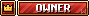{ .rank-tag } | **Owner** | Dirección del servidor |
| 3 | 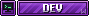{ .rank-tag } | **Developer** | Desarrollo y sistemas técnicos |
| 4 | { .rank-tag } | **Manager** | Gestión del equipo |
| 5 | { .rank-tag } | **Admin** | Administración general |
| 6 | 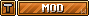{ .rank-tag } | **Moderador** (Mod) | Moderación |
| 7 | { .rank-tag } | **Helper** (Ayudante) | Soporte a jugadores |
| 8 | { .rank-tag } | **T-Helper** (Ayudante de Prueba) | Periodo de prueba |

### Fundador

*Creador de Wolfland Network.*

**Funciones**

- Define la visión, el rumbo y los valores de la comunidad.
- Toma las decisiones finales sobre el proyecto.
- Aprueba cambios importantes en el servidor, en el equipo y en la imagen de la marca.

### Owner

{ .rank-tag-lg }

*Dueño y máximo responsable del servidor.*

**Funciones**

- Tiene control total sobre el servidor, sus configuraciones y sus permisos.
- Supervisa a todo el equipo de staff.
- Gestiona la relación con la comunidad, las alianzas y la tienda.
- Resuelve los casos de mayor gravedad y las apelaciones difíciles.

### Developer

{ .rank-tag-lg }

*Responsable del desarrollo técnico del servidor.*

**Funciones**

- Configura, programa y mantiene los plugins y sistemas propios del servidor.
- Desarrolla nuevas mecánicas y contenido personalizado del Survival Custom.
- Corrige bugs, errores y fallos de rendimiento.
- Mantiene la infraestructura del servidor y sus copias de seguridad.
- Prueba las actualizaciones antes de publicarlas.

### Manager

{ .rank-tag-lg }

*Responsable de organizar y dirigir al equipo.*

**Funciones**

- Coordina al staff y reparte las tareas entre los distintos rangos.
- Gestiona el reclutamiento, la capacitación y la evaluación del equipo.
- Revisa el desempeño del staff y propone ascensos o sanciones internas.
- Organiza eventos y actividades de la comunidad.
- Sirve de enlace entre el staff y la dirección.

### Admin

{ .rank-tag-lg }

*Encargado de la administración diaria del servidor.*

**Funciones**

- Supervisa el funcionamiento general del servidor y de la comunidad.
- Gestiona los permisos y los casos graves de moderación.
- Atiende apelaciones y tickets de mayor complejidad.
- Apoya y guía a moderadores y ayudantes.
- Aplica baneos y sanciones severas según las [reglas](reglas.md).

### Moderador (Mod)

{ .rank-tag-lg }

*Encargado de hacer cumplir las reglas.*

**Funciones**

- Vigila el chat y el juego, dentro y fuera del servidor.
- Aplica advertencias, silencios, expulsiones y baneos según las [reglas](reglas.md).
- Revisa reportes de jugadores y reúne pruebas.
- Atiende tickets de moderación.
- Escala a un Admin los casos que requieren una decisión mayor.

### Helper (Ayudante)

{ .rank-tag-lg }

*Primera línea de ayuda para los jugadores.*

**Funciones**

- Resuelve dudas de jugadores nuevos y antiguos dentro del servidor.
- Orienta sobre las [reglas](reglas.md), los [comandos](comandos.md) y los [rangos](rangos.md).
- Atiende tickets de soporte básicos.
- Avisa a un Moderador cuando detecta una infracción.
- Aplica silencios leves y advertencias cuando corresponde.

### T-Helper (Ayudante de Prueba)

{ .rank-tag-lg }

*Rango temporal para quienes están ingresando al staff.*

**Funciones**

- Aprende el funcionamiento del servidor, las herramientas y los procedimientos del equipo.
- Ayuda a jugadores con dudas sencillas bajo la supervisión de un superior.
- Reporta infracciones, sin aplicar sanciones por su cuenta.

**Periodo de prueba**

- Su desempeño, actividad y actitud son evaluados por el equipo.
- Si supera la prueba, asciende a **Helper**.

### Camino de ascenso

```text
T-Helper  →  Helper  →  Moderador  →  Admin
```

Los rangos de **Developer** y **Manager** se asignan por designación directa de la dirección, según las necesidades del equipo.

!!! info "¿Quieres formar parte del staff?"
    Las vacantes se anuncian en nuestro [Discord](https://discord.com/invite/jCmngqZRFV) y en las [noticias](noticias.md). Para postularte, abre un [ticket](https://discord.com/invite/jCmngqZRFV).

---

## Rangos premium

Rangos con etiqueta exclusiva, kits, más capacidad y comandos exclusivos. Ordenados de mayor a menor.

| Rango | Resumen |
|-------|---------|
| 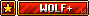{ .rank-tag } | El rango más caro y exclusivo |
| { .rank-tag } | El segundo rango más caro y mejor |
| 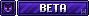{ .rank-tag } | Beneficios avanzados y mesas de trabajo |
| { .rank-tag } | Kits dobles, AFK infinito y enderchest |
| 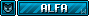{ .rank-tag } | Más capacidad, subastas y trabajos |
| 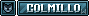{ .rank-tag } | El primer rango premium |
| 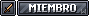{ .rank-tag } | Rango inicial por defecto, sin beneficios extras |

[:material-crown: Ver todos los beneficios de los rangos premium](rangos-premium.md){ .md-button .md-button--primary }

!!! tip "Descuentos"
    Hay descuentos cada cierto tiempo y se anuncian en nuestro [Discord](https://discord.com/invite/jCmngqZRFV). Visita también la [tienda oficial](https://wolfland.tebex.store/).

---

## Rangos media

Rangos para los creadores de contenido que muestran Wolfland Network en sus redes. Todos equivalen a un rango **Alfa** del servidor y tienen rol en Discord, un canal de alertas de redes sociales y un canal exclusivo.

| Etiqueta | Plataforma | Requisito base |
|:--------:|------------|----------------|
| { .rank-tag } | TikTok | Videos con más de 200 vistas o lives de 10 a 50+ viewers |
| { .rank-tag } | YouTube | Videos con más de 500 vistas o reels con más de 1000 vistas, y mínimo 100 suscriptores |
| 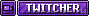{ .rank-tag } | Twitch | Transmisiones con mínimo 10 viewers y mínimo 50 seguidores |
| 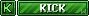{ .rank-tag } | Kick | Igual que Twitch |

[:material-video-account: Ver requisitos, reglas y cómo postular](rangos-media.md){ .md-button .md-button--primary }

---

## Rango Artista

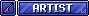{ .rank-tag-lg }

Para artistas y diseñadores, profesionales o no, que ofrecen sus servicios de diseño y arte. Incluye el rango en el servidor y un rol en Discord.

[:material-palette: Ver requisitos y cómo postular](servicios.md#artistas-y-disenadores){ .md-button .md-button--primary }

---

## Rangos exclusivos y caducados

Rangos de temporadas anteriores. **Ya no se pueden obtener.**

| Rango | Expiración |
|-------|:----------:|
| **Veterano+** | 2024 |
| **Veterano** | 2025 |
| **Fenix** | 2025 |
| **Media** | 2026 |
| **Titan** | 2024 - 2026 |
| **Dios** | 2024 - 2026 |
| **Epico** | 2024 - 2026 |
| **Mitico** | 2024 - 2026 |
| **Leyenda** | 2024 - 2026 |
