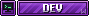
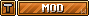
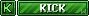

# Staff

Conoce al equipo que cuida Wolfland Network. Las funciones de cada rango están en la página de [rangos](rangos.md#rangos-del-staff).

## Equipo de staff

| Rango | Miembro |
|-------|---------|
| Fundador | Maruchans |
| { .rank-tag } | Jhazz26 |
| { .rank-tag } | _Tommasino_ |
| { .rank-tag } | Vacio |
| { .rank-tag } | Vacio |
| { .rank-tag } | MrCraft |
| { .rank-tag } | TheWynterOne |
| { .rank-tag } | Vacio |

## Creadores de contenido (media)

| Rango | Miembro |
|-------|---------|
| { .rank-tag } | *Nombre* |
| { .rank-tag } | *Nombre* |
| { .rank-tag } | *Nombre* |
| { .rank-tag } | *Nombre* |
